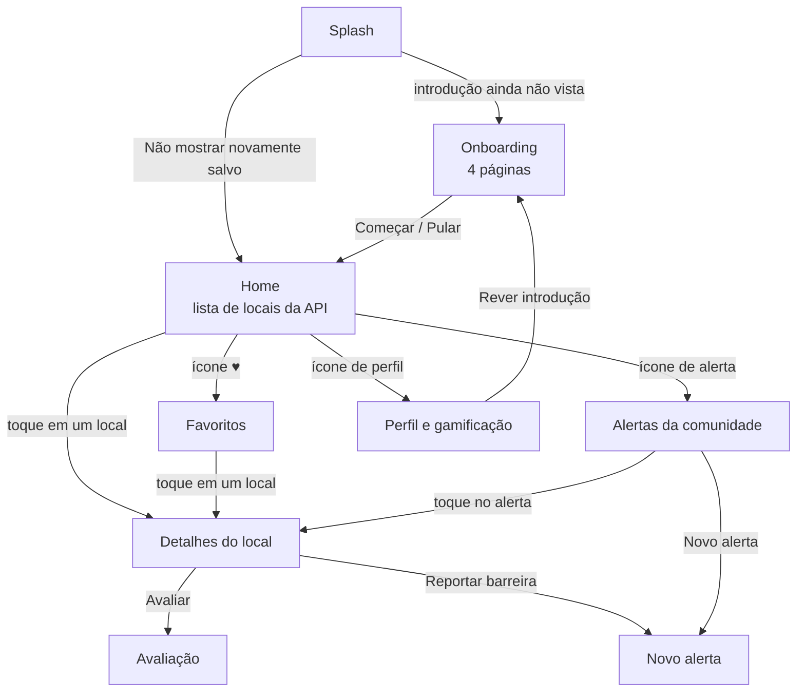
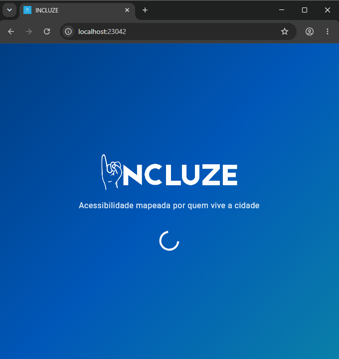
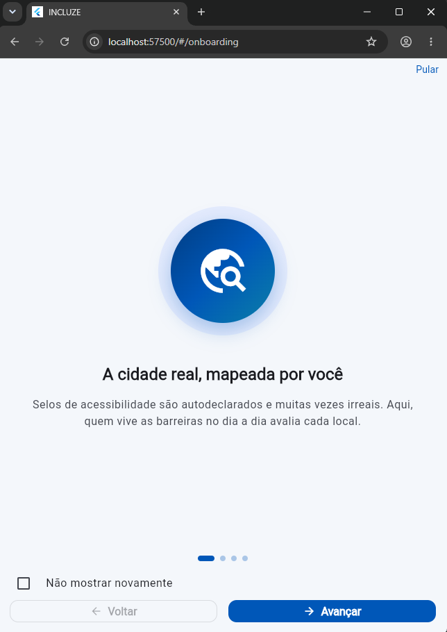
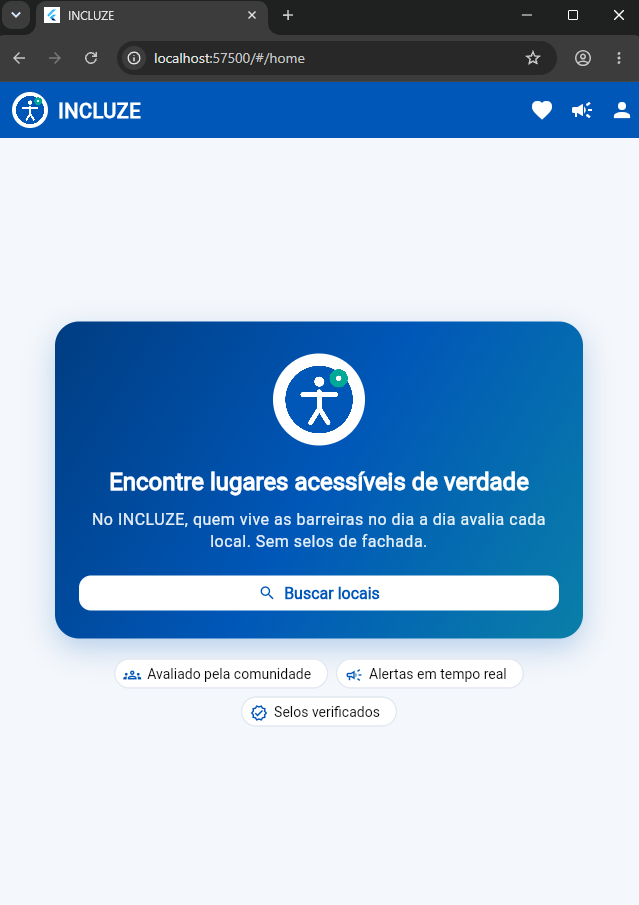
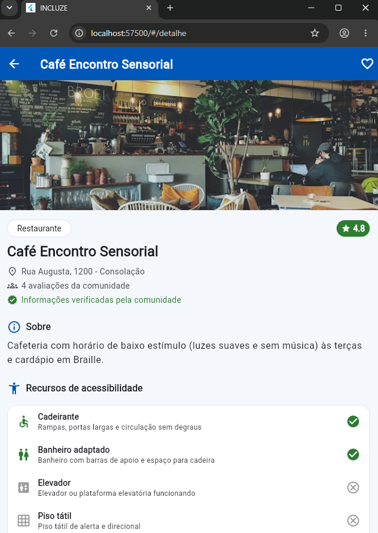
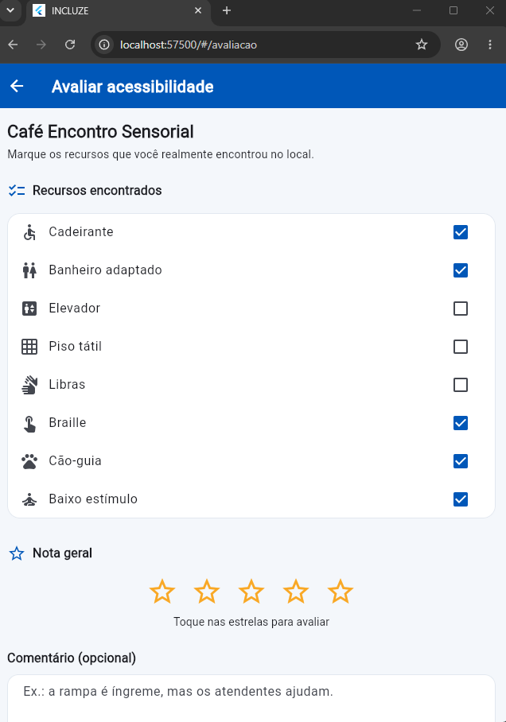
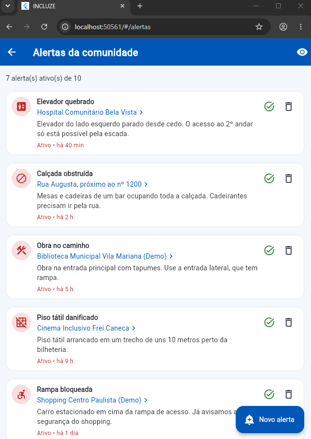
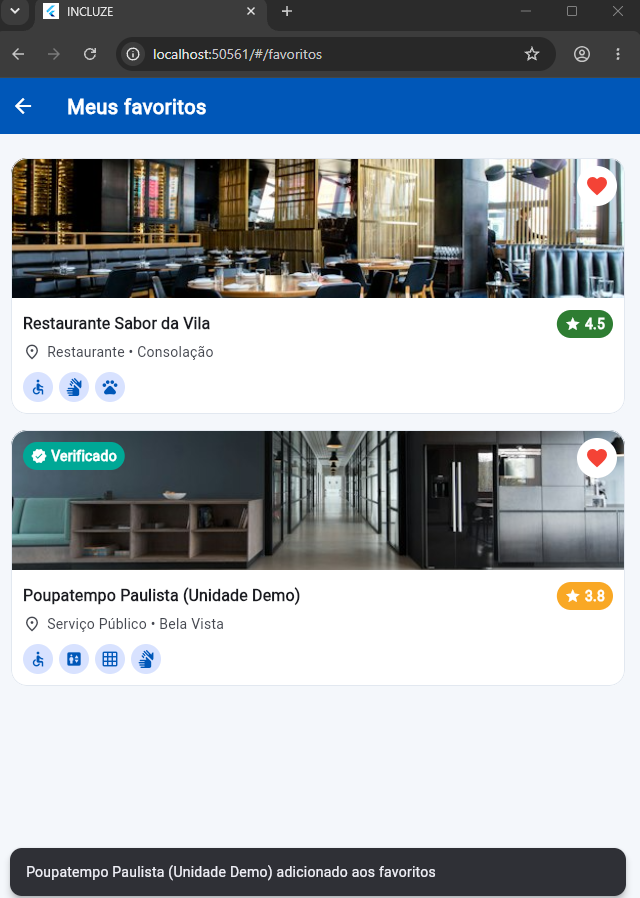
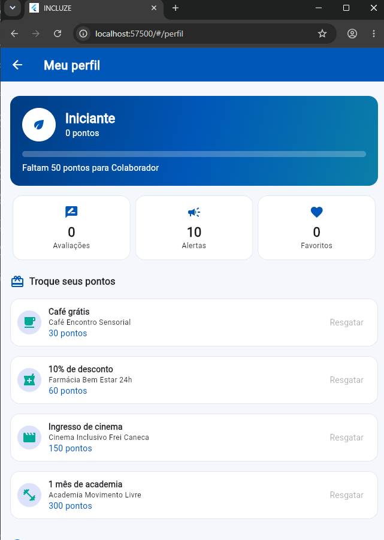

# INCLUZE — Acessibilidade mapeada por quem vive a cidade

> Global Solution 2026 · FIAP · Turma 3SI · App mobile em **Flutter/Dart**

## Desenvolvedores

| Nome completo | RM |
|---|---|
| Murilo Mercadante | 555926 |
| Breno Takase Gomes | 554799 |

## Tema da Global Solution

**CitizenTech** - Soluções tecnológicas focadas em necessidades reais das pessoas e no benefício concreto ao cidadão.

**ODS Principais do Projeto:** **ODS 10 (Redução das Desigualdades)** e **ODS 11 (Cidades e Comunidades Sustentáveis)**.

## Descrição da solução

Cidades e estabelecimentos foram desenhados para um usuário "padrão". Para pessoas com deficiência física, visual, auditiva ou neurodivergências, sair de casa envolve incerteza, porque a informação de acessibilidade costuma ser binária, autodeclarada e muitas vezes irreal.

O **INCLUZE** é um app de **crowdsourcing**: a própria comunidade (pessoas com deficiência, familiares e simpatizantes) **mapeia, avalia e reporta** as condições reais de acessibilidade de espaços públicos e privados.

- **Inclusão invisível:** além de rampas, o app mostra atendimento em **Libras**, materiais em **Braille**, aceitação de **cão-guia** e ambientes de **baixo estímulo** (TEA), entre 8 recursos de acessibilidade.
- **Busca e filtros:** por nome, bairro ou categoria, combinando recursos de acessibilidade.
- **Detalhes do local:** recursos, nota da comunidade, selo de **verificado** e avaliações.
- **Avaliações:** o usuário avalia a acessibilidade de um local e ganha pontos.
- **Alertas da comunidade ("Waze da inclusão"):** barreiras temporárias, como elevador quebrado ou calçada obstruída.
- **Favoritos:** locais salvos para acesso rápido.
- **Gamificação:** +10 pontos por avaliação e +5 por alerta, com níveis (Iniciante, Colaborador, Guardião da Inclusão, Embaixador) e benefícios no comércio parceiro.

## Fluxo de telas



| Tela | Rota | O que faz |
|---|---|---|
| Splash | `/` | Exibe o logo e, após a animação, consulta o **SharedPreferences** para decidir entre Onboarding e Home |
| Onboarding | `/onboarding` | 4 páginas com ícone, título e descrição; botões **Voltar/Avançar**; opção **"Não mostrar novamente"** salva no SharedPreferences |
| Home | `/home` | Lista de locais vinda da **API REST**, com busca, filtros por recurso e *pull-to-refresh* |
| Detalhes do local | `/detalhe` | Recebe o `Local` como **parâmetro** de rota; mostra recursos, nota e selo; permite favoritar, avaliar e reportar |
| Avaliação | `/avaliacao` | Nota e comentário; devolve os pontos ganhos para a tela anterior (`Navigator.pop` com resultado) |
| Alertas | `/alertas` | Barreiras reportadas; abre o local relacionado e permite excluir alertas |
| Novo alerta | `/novo-alerta` | Formulário de nova barreira temporária (+5 pontos) |
| Favoritos | `/favoritos` | Locais favoritados, recebidos da Home como parâmetro |
| Perfil | `/perfil` | Pontos, nível, benefícios, estatísticas, ODS e opção de rever a introdução |

## API utilizada

O app consome a **API REST desenvolvida pelo próprio grupo**: Java + Spring Boot + Microsoft SQL Server, publicada no **Microsoft Azure** (Container Apps + Azure SQL).

| | |
|---|---|
| Repositório da API | https://github.com/MuriloMercadante/Incluze.Micro |
| Documentação (Swagger) | https://rm554799-incluze-api.livelytree-72ea2755.brazilsouth.azurecontainerapps.io/ |
| **Endpoint consumido** | `GET https://rm554799-incluze-api.livelytree-72ea2755.brazilsouth.azurecontainerapps.io/api/v1/locais/app` |

Exemplo de item retornado:

```json
{
  "id": 12,
  "nome": "Café Encontro Sensorial",
  "categoria": "Restaurante",
  "endereco": "Rua Augusta, 1200",
  "bairro": "Consolação",
  "descricao": "Cafeteria com horário de baixo estímulo (luzes suaves e sem música) às terças e cardápio em Braille.",
  "imagem": "https://images.unsplash.com/photo-1554118811-1e0d58224f24?w=600&h=400&fit=crop&q=80",
  "nota": 4.8,
  "avaliacoes": 4,
  "verificado": true,
  "recursos": ["cadeirante", "banheiro_adaptado", "braille", "cao_guia", "baixo_estimulo"]
}
```

- A requisição usa o pacote **`http`** (`LocalService.buscarLocais`), com tempo limite de 15 s.
- O JSON é convertido em objetos Dart pelo model `Local.fromJson`.
- A Home trata os 4 estados do enum `EstadoTela`: **inicial**, **carregando** (indicador de progresso), **sucesso** (lista) e **erro**. No erro, aparece uma mensagem amigável (sem internet, tempo esgotado, erro do servidor, dados inválidos) e o botão **"Tentar novamente"**.
- Na API, a nota, o total de avaliações e o selo **verificado** (3 ou mais avaliações que confirmaram a acessibilidade no local) são calculados a partir das avaliações gravadas no banco.

> O banco da API usa a camada gratuita serverless do Azure SQL, que pausa após um período sem uso. Se a primeira abertura do app mostrar erro de tempo esgotado, toque em **"Tentar novamente"**: o banco leva alguns segundos para retomar.

O arquivo [`api/locais.json`](api/locais.json) contém uma amostra no mesmo formato da API e é usado pelos testes automatizados (`test/local_service_test.dart`), que simulam as respostas HTTP sem depender da rede.

## Arquitetura

```text
lib/
├── main.dart              # MaterialApp, tema e rotas
├── routes/                # AppRoutes: rotas nomeadas
├── screens/               # telas (interface)
├── widgets/               # widgets reutilizáveis (LocalCard, NotaBadge, RecursoChip, EstadoMensagem...)
├── models/                # modelos de dados (Local, Avaliacao, Alerta, EstadoTela, RecursoAcessibilidade...)
├── services/              # regras de negócio e acesso a dados (API e SharedPreferences)
├── data/                  # dados de demonstração (alertas de exemplo)
└── utils/                 # constantes, tema e formatação
```

| Camada | Responsabilidade |
|---|---|
| **Telas** (`screens`) | Montam a interface e reagem às ações do usuário. Não contêm regra de negócio: delegam aos services |
| **Widgets** (`widgets`) | Componentes visuais reutilizados em várias telas, por exemplo `LocalCard` na Home e em Favoritos, e `EstadoMensagem` para erro e lista vazia |
| **Models** (`models`) | Estruturas de dados e conversão JSON (`fromJson` / `toJson`) |
| **Services** (`services`) | `LocalService` (HTTP, busca e filtros), `FavoritoService`, `AvaliacaoService`, `AlertaService`, `GamificacaoService` e `OnboardingService` (SharedPreferences) |

**Gerenciamento de estado:** `StatefulWidget` com `setState` nas telas que mudam com a interação (Home, Detalhes, Onboarding, Favoritos, Alertas, Avaliação, Perfil). Componentes de apresentação são `StatelessWidget`.

**Persistência local (SharedPreferences):** introdução vista, favoritos, avaliações, alertas e pontos.

**Navegação:** rotas nomeadas (`Navigator.pushNamed`), passagem de parâmetros (`arguments`, por exemplo o `Local` para a tela de detalhes) e retorno com resultado (`Navigator.pop(context, pontos)`).

## Prints das telas

| Splash | Onboarding | Home |
| :---: | :---: | :---: |
|  |  |  |

| Busca e filtros | Detalhes do local | Avaliação |
| :---: | :---: | :---: |
|  |  |  |

| Alertas | Favoritos | Perfil |
| :---: | :---: | :---: |
|  |  |  |

## Requisitos atendidos

| Requisito | Onde |
|---|---|
| Splash com logo, transição automática e SharedPreferences | `splash_screen.dart`, `onboarding_service.dart` |
| Onboarding com ≥ 3 páginas, voltar/avançar e "Não mostrar novamente" | `onboarding_screen.dart`, `onboarding_item.dart` (4 páginas) |
| ≥ 4 telas principais, parâmetros e retorno | Home, Detalhes, Avaliação, Alertas, Novo alerta, Favoritos e Perfil |
| WebService com `http`, models e 4 estados | `local_service.dart`, `local.dart`, `estado_tela.dart`, `home_screen.dart` |
| Widgets: Column, Row, Card, ListView, Scaffold, AppBar, botões, Icon/IconButton, Image.asset/Image.network | `app_logo.dart` (Image.asset), `local_imagem.dart` (Image.network), demais telas e widgets |
| Interações: abrir detalhes, busca/filtros, favoritar, avaliar, reportar, *pull-to-refresh* | Home, Detalhes, Favoritos, Alertas |
| Organização, `setState` e separação interface/modelos/serviços | Estrutura de pastas acima |

## Como executar

Pré-requisito: [Flutter SDK](https://docs.flutter.dev/get-started/install) 3.x.

```bash
flutter pub get
flutter run          # escolha um emulador Android/iOS, Chrome ou Windows
```

Testes automatizados e análise estática:

```bash
flutter test
flutter analyze
```
.
